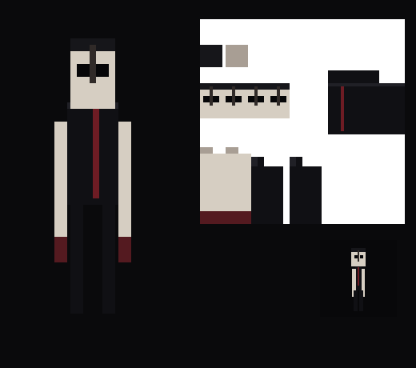

# The Creator

A Minecraft Bedrock horror add-on. It is separate from the Yapper app in this repository.

The Creator is an original stalker. The slow watch from just past where you want to look is the part taken from the Twixxel kind of Minecraft horror. The figure, the lines, the texture, and the mood rules are not from that creator's mods. This pack is not affiliated with Twixxel or Mojang.

It keeps a **7 in-game day** count on the action bar and the sidebar. A Minecraft day is 20 minutes, so the week is the week you play, including time you skip in a bed. Ungratefulness is a second clock. It starts pseudo-helpful and, if you ignore it, turns aggressively hostile before the week is over. The calendar still arrives on day 7 even if you have been polite.

## Download

[The-Creator.mcaddon](https://github.com/sylisstejskal-bot/Yapper/raw/refs/heads/cursor/the-creator-horror-2a58/the-creator/dist/The-Creator.mcaddon)

The same file is in this folder at `dist/The-Creator.mcaddon`.

Needs Minecraft Bedrock **1.26** or newer. The script module is stable `@minecraft/server` **2.11.0**. Leave the Beta APIs experiment off.

## Install

1. Download `The-Creator.mcaddon` and open it with Minecraft. That imports **The Creator** and **The Creator Resources**.
2. Edit a world, activate both packs, and join.
3. The action bar shows days left, the day number, the phase, and ungratefulness percent. The sidebar shows the same numbers.

On the first join you get one **Offering**. More are under Items in the creative inventory. A spawn egg is there too, for testing. The pack keeps a single figure and removes extras.

## What it does

| Phase | When | Distance | Behavior |
| --- | --- | --- | --- |
| The Witness | Days 1–2, mood under 25% | About 34 blocks, behind you | Leaves bread, food, or torches. Places a torch if the night is dark. Vanishes if you stare or walk up to it. |
| The Debt | Days 3–4, or mood 25% | About 22 blocks | Gifts turn into rotten flesh and spider eyes. Short thunderstorms. Torches go out. It still leaves if watched. |
| The Grudge | Days 5–6, or mood 50% | About 13 blocks | It stops fleeing. Thunder, lightning nearby, darkness, a knock behind you. It hurts if you let it get close. |
| The Reckoning | Day 7, or mood 75% | About 6 blocks | Storms stick. It blinks in front of you, slows you, and hits harder. At 0 days left the count stays on screen. |

Ungratefulness moves like this:

- Rises slowly on its own, faster at night.
- **+12** if you hit it. Killing it adds **40** and it is back behind you after 12 seconds.
- **+8** if you drop an item it gave you (the name starts with `Gift:`).
- **+6** the first time someone sleeps each in-game day.
- **−12** if you hold and finish using an Offering.
- **−8** if you drop any other item within 4 blocks of it. It takes the item.
- **−5** if you hold your look on it for a couple of seconds (about once a minute). In the early phases it then vanishes.
- **−8** if chat contains "thank". That event exists only on newer script builds. The Offering works either way.

Cheats can force a test state:

```
/scriptevent creator:mood 80
/scriptevent creator:add 10
/scriptevent creator:day 6
```

`creator:day 6` jumps the calendar to the last day. `creator:mood 0` does not rewind the calendar.

## Pack layout

`behavior_pack` is the entity, the offering, and the script. `resource_pack` is the model, the texture, and the names. `tools/make_art.py` regenerates the texture, the icon, and `models/entity/the_creator.geo.json` together so the UVs cannot drift.

```bash
python3 the-creator/tools/make_art.py
python3 the-creator/tools/pack.py
node --test the-creator/test/logic.test.mjs
```

The figure is tall, pale, and featureless except for the eyes. It does not walk. It appears.


